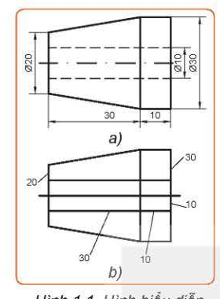
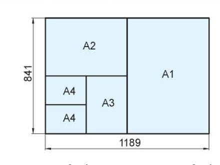
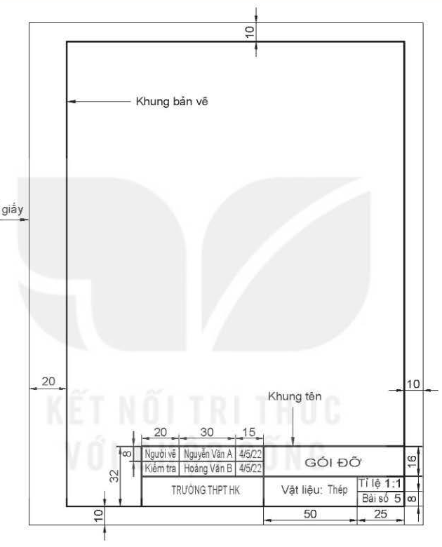

# BÀI 1: MỘT SỐ TIÊU CHUẨN TRÌNH BÀY BẢN VẼ KĨ THUẬT

> **Mục tiêu bài học:**
> - Mô tả được các tiêu chuẩn cơ bản về khổ giấy, tỉ lệ, đường nét và ghi kích thước trên bản vẽ kĩ thuật.
> - Hiểu và áp dụng đúng Tiêu chuẩn Việt Nam (TCVN) khi lập và đọc bản vẽ.

---

### Khởi động

Quan sát hai hình biểu diễn cùng một vật thể: một hình được vẽ theo đúng tiêu chuẩn kĩ thuật, một hình vẽ tùy ý không theo quy chuẩn. Bản vẽ kĩ thuật không theo tiêu chuẩn sẽ gây hiểu nhầm, khó khăn cho người gia công và chế tạo.

> [!NOTE]
> **Bản vẽ kĩ thuật** là tài liệu kĩ thuật được trình bày dưới dạng hình vẽ, diễn đạt hình dạng, kết cấu, kích thước và các yêu cầu kĩ thuật của sản phẩm. Bản vẽ kĩ thuật được lập theo các quy tắc thống nhất quy định trong các **Tiêu chuẩn Việt Nam (TCVN)** hoặc tiêu chuẩn quốc tế (ISO).

---

## I. Khổ Giấy (TCVN 7285:2003)

Khổ giấy của các bản vẽ kĩ thuật được quy định nghiêm ngặt trong tiêu chuẩn **TCVN 7285:2003 (ISO 5457:1999)**.

### 1. Các khổ giấy chính
Các khổ giấy chính bao gồm $A0, A1, A2, A3, A4$. Các khổ giấy này được tạo ra từ khổ giấy $A0$ bằng cách chia đôi theo chiều dài.

| Kí hiệu khổ giấy | Kích thước $(Dài \times Rộng)$ tính theo $mm$ |
| :---: | :---: |
| **A0** | $1189 \times 841$ |
| **A1** | $841 \times 594$ |
| **A2** | $594 \times 420$ |
| **A3** | $420 \times 297$ |
| **A4** | $297 \times 210$ |

### 2. Khung bản vẽ và khung tên
- **Khung bản vẽ:** Được vẽ bằng nét liền đậm, cách mép giấy:
  - Cạnh lề bên trái: rộng $20\text{ mm}$ (dùng để đóng thành tập).
  - Ba cạnh lề còn lại: rộng $10\text{ mm}$ (đối với khổ giấy nhỏ như A4 có thể là $5\text{ mm}$).
- **Khung tên:** Được đặt ở góc dưới cùng bên phải của bản vẽ kĩ thuật. Đối với khổ A4, khung tên luôn được đặt ở cạnh ngắn hơn (cạnh đáy) của vùng vẽ.

---

## II. Tỉ Lệ (TCVN 7286:2003)

**Tỉ lệ** là tỉ số giữa kích thước dài đo được trên hình biểu diễn của vật thể và kích thước thực tương ứng trên vật thể đó.

$$\text{Tỉ lệ} = \frac{\text{Kích thước trên bản vẽ}}{\text{Kích thước thực của vật thể}}$$

| Nhóm tỉ lệ | Kí hiệu theo tiêu chuẩn | Ý nghĩa |
| :--- | :--- | :--- |
| **Tỉ lệ thu nhỏ** | $1:2, 1:5, 1:10, 1:20, 1:50, 1:100\dots$ | Vật thể lớn được vẽ nhỏ lại trên giấy |
| **Tỉ lệ nguyên hình** | $1:1$ | Kích thước trên bản vẽ bằng đúng kích thước thực |
| **Tỉ lệ phóng to** | $2:1, 5:1, 10:1, 20:1, 50:1\dots$ | Chi tiết vi mô nhỏ được phóng to để nhìn rõ |

> [!TIP]
> Dù vẽ theo bất kỳ tỉ lệ thu nhỏ hay phóng to nào thì con số kích thước ghi trên bản vẽ **luôn luôn là kích thước thực** của vật thể!

---

## III. Nét Vẽ (TCVN 8-24:2002)

Quy định các nét vẽ cơ bản dùng trong bản vẽ kỹ thuật:

| Tên gọi nét vẽ | Hình dạng nét | Ứng dụng chính |
| :--- | :---: | :--- |
| **Nét liền đậm** | ━━━ | Đường bao thấy, cạnh thấy của vật thể |
| **Nét liền mảnh** | ─── | Đường gióng, đường ghi kích thước, đường gạch mặt cắt |
| **Nét đứt mảnh** | ┈┈┈ | Đường bao khuất, cạnh khuất bên trong |
| **Nét gạch dài - chấm - mảnh** | ━ ⬝ ━ ⬝ ━ | Đường tâm, đường trục đối xứng |

> **Quy chuẩn độ dày nét vẽ:** Chiều rộng nét đậm thường chọn $s = 0.5\text{ mm}$, nét mảnh lấy bằng một nửa nét đậm: $s_{mảnh} \approx \frac{1}{2}s = 0.25\text{ mm}$.

---

## IV. Ghi Kích Thước (TCVN 5705:1993)

Ghi kích thước bao gồm 3 thành phần chính:
1. **Đường gióng kích thước:** Kẻ bằng nét liền mảnh, vượt quá đầu mũi tên của đường kích thước từ $2$ đến $4\text{ mm}$.
2. **Đường kích thước:** Kẻ bằng nét liền mảnh, song song với kích thước cần đo, hai đầu có mũi tên chạm vào đường gióng.
3. **Con số kích thước:** 
   - Chỉ giá trị số kích thước thực (không phụ thuộc tỉ lệ vẽ).
   - Đơn vị đo độ dài mặc định là **milimét (mm)** &rarr; không cần ghi chữ "mm" sau con số.
   - Ký hiệu $\varnothing$ đặt trước số đo đường kính hình tròn (ví dụ: $\varnothing 30$).
   - Ký hiệu $R$ đặt trước số đo bán kính cung tròn (ví dụ: $R10$).

