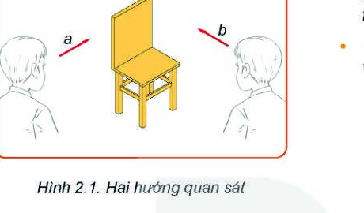
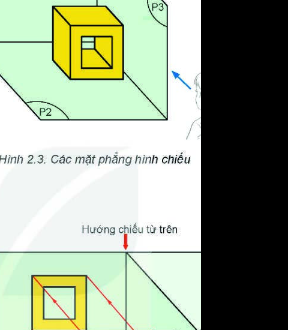
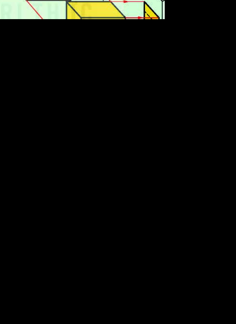
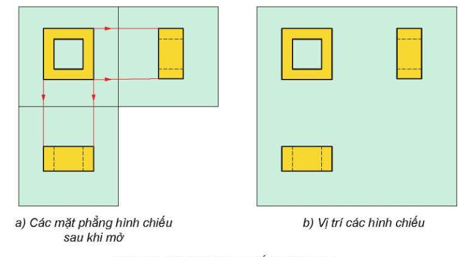
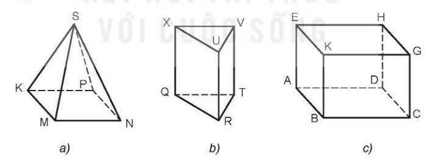

# BÀI 2: HÌNH CHIẾU VUÔNG GÓC

> **Mục tiêu bài học:**
> - Vẽ được hình chiếu vuông góc của khối đa diện, khối tròn xoay thường gặp theo phương pháp chiếu góc thứ nhất.
> - Bố trí đúng vị trí các hình chiếu trên bản vẽ kĩ thuật.
> - Đọc và ghi được kích thước các hình chiếu của vật thể đơn giản.

---

### Khởi động

Khi quan sát một chiếc ghế từ hai phía khác nhau (nhìn từ trước và nhìn từ cạnh bên), hình ảnh thu được sẽ hoàn toàn khác nhau. Để diễn tả chính xác hình dạng không gian 3 chiều của một vật thể lên mặt giấy 2 chiều, người ta dùng **phương pháp các hình chiếu vuông góc**.

---

## I. Phương Pháp Các Hình Chiếu Vuông Góc

### 1. Khái niệm tia chiếu và mặt phẳng chiếu
- Các tia chiếu song song với nhau và cùng **vuông góc** với mặt phẳng hình chiếu.
- Hình nhận được trên mặt phẳng chiếu gọi là **hình chiếu vuông góc**.

### 2. Ba mặt phẳng hình chiếu chính
Trong phương pháp chiếu góc thứ nhất, vật thể được đặt trong một góc tạo bởi 3 mặt phẳng vuông góc từng đôi một:

1. **Mặt phẳng hình chiếu đứng ($P_1$):** Mặt phẳng thẳng đứng ở chính diện.
2. **Mặt phẳng hình chiếu bằng ($P_2$):** Mặt phẳng nằm ngang ở đáy.
3. **Mặt phẳng hình chiếu cạnh ($P_3$):** Mặt phẳng thẳng đứng ở bên phải.

### 3. Ba hình chiếu vuông góc
- **Hình chiếu đứng:** Chiếu từ trước tới lên mặt phẳng $P_1$, thể hiện chiều cao và chiều dài.
- **Hình chiếu bằng:** Chiếu từ trên xuống lên mặt phẳng $P_2$, thể hiện chiều dài và chiều rộng.
- **Hình chiếu cạnh:** Chiếu từ trái sang lên mặt phẳng $P_3$, thể hiện chiều cao và chiều rộng.

### 4. Vị trí các hình chiếu trên bản vẽ kĩ thuật
Sau khi chiếu, để đưa các hình chiếu về cùng một mặt phẳng giấy vẽ:
- Mặt phẳng hình chiếu bằng $P_2$ được xoay xuống dưới một góc $90^\circ$.
- Mặt phẳng hình chiếu cạnh $P_3$ được xoay sang phải một góc $90^\circ$.

> [!IMPORTANT]
> **Quy tắc vàng về bố trí vị trí:**
> - **Hình chiếu bằng** luôn luôn đặt **ở dưới** hình chiếu đứng.
> - **Hình chiếu cạnh** luôn luôn đặt **ở bên phải** hình chiếu đứng.
> - Đường gióng giữa hình chiếu đứng và hình chiếu bằng gióng thẳng đứng hàng dọc (cùng chiều dài).
> - Đường gióng giữa hình chiếu đứng và hình chiếu cạnh gióng ngang hàng ngang (cùng chiều cao).

---

## II. Hình Chiếu Vuông Góc Của Khối Đa Diện

Khối đa diện được bao bọc bởi các hình đa giác phẳng.

### 1. Đặc điểm hình chiếu của các khối đa diện

| Khối đa diện | Hình chiếu đứng | Hình chiếu bằng | Hình chiếu cạnh |
| :--- | :--- | :--- | :--- |
| **Hình hộp chữ nhật** | Hình chữ nhật | Hình chữ nhật | Hình chữ nhật |
| **Hình lăng trụ tam giác đều** | Hình chữ nhật | Hình tam giác đều | Hình chữ nhật |
| **Hình chóp tứ giác đều** | Hình tam giác cân | Hình vuông (có 2 đường chéo) | Hình tam giác cân |

---

## III. Hình Chiếu Vuông Góc Của Khối Tròn Xoay

Khối tròn xoay được tạo thành khi quay một hình phẳng quanh một trục cố định.

| Khối tròn xoay | Hình chiếu đứng | Hình chiếu bằng | Hình chiếu cạnh |
| :--- | :--- | :--- | :--- |
| **Hình trụ** | Hình chữ nhật | Hình tròn (có tâm) | Hình chữ nhật |
| **Hình nón** | Hình tam giác cân | Hình tròn (có tâm) | Hình tam giác cân |
| **Hình cầu** | Hình tròn (có đường tâm) | Hình tròn (có đường tâm) | Hình tròn (có đường tâm) |

> [!NOTE]
> Đối với khối tròn xoay, hình chiếu nào có dạng hình tròn bắt buộc phải vẽ **hai đường tâm vuông góc** cắt nhau bằng nét gạch dài - chấm - mảnh.

---

## IV. Trình Tự Vẽ Hình Chiếu Vuông Góc Của Vật Thể Đơn Giản

Để vẽ hình chiếu của một chi tiết kỹ thuật, tiến hành theo 3 bước chuẩn mực:
- **Bước 1 — Phân tích hình dạng:** Coi vật thể là sự kết hợp của các khối hình học cơ bản (khối đa diện, khối tròn xoay) và phần bị cắt gọt.
- **Bước 2 — Chọn hướng chiếu:** Chọn hướng nhìn từ trước biểu diễn rõ nhất hình dạng đặc trưng của vật thể làm hình chiếu đứng.
- **Bước 3 — Vẽ các hình chiếu:** 
  1. Vẽ hình chiếu đứng trước.
  2. Dùng đường gióng gióng xuống để vẽ hình chiếu bằng.
  3. Dùng đường gióng ngang và góc $45^\circ$ để vẽ hình chiếu cạnh.
  4. Tô đậm các nét thấy, kẻ nét đứt cho các cạnh khuất, kẻ đường tâm và ghi kích thước.
