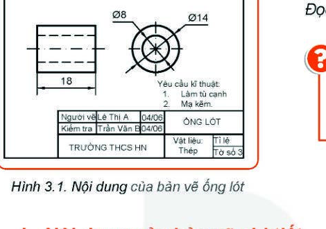

# BÀI 3: BẢN VẼ CHI TIẾT

> **Mục tiêu bài học:**
> - Nêu được nội dung và công dụng của bản vẽ chi tiết.
> - Đọc được bản vẽ chi tiết đơn giản theo đúng trình tự tiêu chuẩn.

---

### Khởi động

Khi chế tạo một cỗ máy, mỗi bộ phận cơ khí dù là chiếc ốc vít hay trục quay đều cần một tài liệu kĩ thuật riêng biệt mô tả chính xác từng đường nét, kích thước và vật liệu chế tạo. Tài liệu đó chính là **Bản vẽ chi tiết**.

---

## I. Nội Dung Của Bản Vẽ Chi Tiết

Một bản vẽ chi tiết đạt chuẩn kỹ thuật bao gồm **4 nội dung cơ bản**:

1. **Hình biểu diễn:** 
   - Gồm các hình chiếu vuông góc (hình chiếu đứng, bằng, cạnh) hoặc hình cắt diễn tả hình dạng bên ngoài và cấu tạo rỗng bên trong của chi tiết.
2. **Kích thước:**
   - Thể hiện đầy đủ kích thước các phần của chi tiết và kích thước định vị các lỗ, ren, rãnh để thợ cơ khí gia công chính xác.
3. **Yêu cầu kĩ thuật:**
   - Ghi các chỉ dẫn về gia công (làm tù cạnh, mạ kẽm, tôi cứng, mài bóng...) và xử lý bề mặt chống gỉ sét.
4. **Khung tên:**
   - Đặt ở góc dưới bên phải bản vẽ, gồm: Tên gọi chi tiết, vật liệu chế tạo, tỉ lệ bản vẽ, mã số bản vẽ, họ tên người vẽ, người kiểm tra và cơ sở sản xuất / trường học.

---

## II. Trình Tự Đọc Bản Vẽ Chi Tiết

Đọc bản vẽ chi tiết phải tuân thủ nghiêm ngặt theo **trình tự 5 bước** khoa học từ tổng quát đến chi tiết:

| Bước | Nội dung cần đọc | Ý nghĩa & Mục đích |
| :---: | :--- | :--- |
| **1. Khung tên** | • Tên gọi chi tiết • Vật liệu chế tạo • Tỉ lệ bản vẽ | Biết chi tiết tên là gì, làm bằng kim loại hay phi kim, vẽ thu nhỏ hay phóng to. |
| **2. Hình biểu diễn** | • Tên gọi các hình chiếu • Vị trí mặt phẳng cắt (nếu có) | Hình dung được hướng nhìn và hình dáng tổng quát bên ngoài, bên trong. |
| **3. Kích thước** | • Kích thước chung $(Dài \times Rộng \times Cao)$ • Kích thước các phần tử (đường kính lỗ, then, ren) | Nắm được độ lớn thực tế của chi tiết khi chế tạo. |
| **4. Yêu cầu kĩ thuật** | • Gia công cơ khí • Xử lý nhiệt luyện, mạ phủ bề mặt | Đảm bảo chi tiết đạt độ bền, độ nhẵn và chống oxy hóa. |
| **5. Tổng hợp** | • Mô tả hình dạng 3D của chi tiết • Công dụng của chi tiết trong bộ phận máy | Đánh giá tổng quan xem chi tiết lắp vào cụm máy nào và hoạt động ra sao. |

---

### Ví dụ Thực Hành Đọc: Bản Vẽ Ống Lót (Hình 3.1)

- **Khung tên:** 
  - Tên chi tiết: *Ống lót*
  - Vật liệu: *Thép*
  - Tỉ lệ: *1:1*
- **Hình biểu diễn:** 
  - Hình chiếu đứng có hình cắt cục bộ thể hiện lỗ rỗng bên trong.
  - Hình chiếu cạnh biểu diễn đường kính ngoài và lỗ trong.
- **Kích thước:**
  - Đường kính ngoài: $\varnothing 14\text{ mm}$
  - Đường kính lỗ trong: $\varnothing 8\text{ mm}$
  - Chiều dài ống: $18\text{ mm}$
- **Yêu cầu kĩ thuật:**
  - 1. Làm tù cạnh.
  - 2. Mạ kẽm.
- **Tổng hợp:** Chi tiết hình trụ rỗng hai đầu, dùng để lót trục trong các ổ trượt cơ khí giúp giảm ma sát và chống mài mòn.
