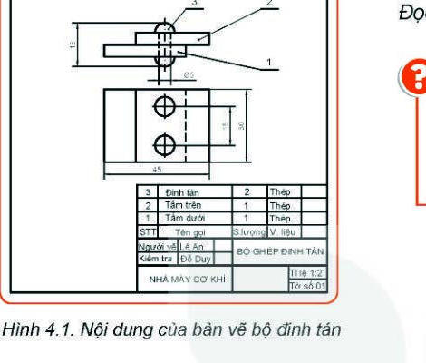

# BÀI 4: BẢN VẼ LẮP

> **Mục tiêu bài học:**
> - Nêu được nội dung và công dụng của bản vẽ lắp.
> - So sánh được sự khác biệt cơ bản giữa bản vẽ chi tiết và bản vẽ lắp.
> - Đọc được bản vẽ lắp đơn giản theo đúng quy trình kĩ thuật.

---

### Khởi động

Khi mua một chiếc quạt điện hay một chiếc xe đạp về nhà, chúng ta thường thấy một tờ sơ đồ hướng dẫn chỉ rõ từng linh kiện được lắp ráp vào đâu, sử dụng ốc vít nào. Trong công nghiệp, sơ đồ đó chính là **Bản vẽ lắp**.

---

## I. Nội Dung Của Bản Vẽ Lắp

Bản vẽ lắp thể hiện hình dáng, vị trí tương quan và kết cấu lắp ghép của một cụm chi tiết hoặc sản phẩm hoàn chỉnh, gồm **4 nội dung chính**:

1. **Hình biểu diễn:**
   - Các hình chiếu, hình cắt thể hiện vị trí lắp ráp, sự ăn khớp giữa các chi tiết với nhau.
2. **Kích thước:**
   - **Kích thước chung:** Chiều dài, chiều rộng, chiều cao tổng thể của toàn bộ sản phẩm.
   - **Kích thước lắp ghép:** Kích thước của các bề mặt tiếp xúc, ăn khớp nhau giữa các chi tiết (ví dụ: đường kính lỗ và trục lắp khớp).
3. **Bảng kê:**
   - Đặt ngay phía trên khung tên, liệt kê đầy đủ: Số thứ tự (STT), Tên gọi từng chi tiết, Số lượng (SL), Vật liệu chế tạo.
4. **Khung tên:**
   - Tên gọi sản phẩm / cụm lắp ráp, tỉ lệ vẽ, mã số hiệu, cơ sở sản xuất.

> [!NOTE]
> **Điểm khác biệt cốt lõi:**
> - Bản vẽ lắp **CÓ Bảng kê**, nhưng **KHÔNG CÓ Yêu cầu kĩ thuật** (vì yêu cầu gia công chi tiết đã có ở từng bản vẽ chi tiết riêng lẻ).
> - Bản vẽ chi tiết **CÓ Yêu cầu kĩ thuật**, nhưng **KHÔNG CÓ Bảng kê**.

---

## II. Trình Tự Đọc Bản Vẽ Lắp

Quy trình đọc bản vẽ lắp chuẩn gồm **6 bước**:

| Bước | Nội dung đọc | Ý nghĩa & Thao tác |
| :---: | :--- | :--- |
| **1. Khung tên** | • Tên sản phẩm • Tỉ lệ bản vẽ | Biết tên bộ phận/cụm máy đang được lắp ráp. |
| **2. Bảng kê** | • Số lượng chi tiết • Tên từng chi tiết & vật liệu | Đếm số chủng loại và tổng số chi tiết cần có để lắp ráp. |
| **3. Hình biểu diễn** | • Tên các hình chiếu • Các hình cắt | Xác định các góc nhìn và mặt cắt quan sát bên trong cụm lắp. |
| **4. Kích thước** | • Kích thước bao $(D \times R \times C)$ • Kích thước lắp ghép | Biết không gian chiếm chỗ và độ chặt khi lắp các chi tiết. |
| **5. Phân tích chi tiết** | • Vị trí từng chi tiết • Mối quan hệ chuyển động | Tìm vị trí của từng chi tiết (theo số thứ tự 1, 2, 3...) trên hình biểu diễn. |
| **6. Tổng hợp** | • Trình tự tháo, lắp • Công dụng sản phẩm | Tưởng tượng trình tự lắp ráp: chi tiết nào lắp trước, chi tiết nào lắp sau và cách vận hành. |

---

### Ví dụ Thực Hành Đọc: Bộ Đinh Tán (Hình 4.1)

1. **Khung tên:** Bộ ghép đinh tán, tỉ lệ 1:2.
2. **Bảng kê:** 
   - Chi tiết 1: Tấm dưới (SL: 1, Thép)
   - Chi tiết 2: Tấm trên (SL: 1, Thép)
   - Chi tiết 3: Đinh tán (SL: 2, Thép)
3. **Hình biểu diễn:** Hình chiếu đứng có cắt bán phần, hình chiếu bằng.
4. **Kích thước:**
   - Kích thước chung: Dài $45\text{ mm}$, Rộng $30\text{ mm}$, Cao $18\text{ mm}$.
   - Kích thước lắp: Đường kính đinh tán $\varnothing 5\text{ mm}$.
5. **Phân tích chi tiết:** Tấm trên đặt chồng lên tấm dưới, hai chiếc đinh tán xuyên qua lỗ của cả hai tấm để liên kết cố định hai tấm lại với nhau.
6. **Tổng hợp:** Trình tự lắp: Đặt tấm dưới &rarr; Đặt tấm trên trùng lỗ &rarr; Xỏ 2 đinh tán &rarr; Tán đầu đinh.
