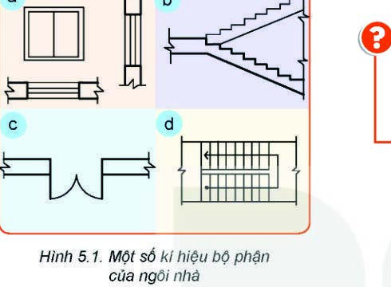

# BÀI 5: BẢN VẼ NHÀ

> **Mục tiêu bài học:**
> - Nêu được nội dung, vai trò của bản vẽ nhà và các hình biểu diễn chính: Mặt bằng, Mặt đứng, Mặt cắt.
> - Nhận biết được các kí hiệu quy ước cơ bản trên bản vẽ xây dựng.
> - Đọc được bản vẽ nhà một tầng đơn giản theo đúng trình tự.

---

### Khởi động

Để thợ xây dựng có thể xây nên một ngôi nhà kiên cố, tiện nghi đúng theo ý muốn của gia chủ, kiến trúc sư phải tạo ra **Bản vẽ nhà**. Trên bản vẽ có các kí hiệu quy ước đại diện cho các bộ phận cửa đi, cửa sổ, cầu thang...

---

## I. Các Hình Biểu Diễn Chính Trên Bản Vẽ Nhà

Một bộ bản vẽ nhà hoàn chỉnh thường có 3 hình biểu diễn cốt lõi:

### 1. Mặt bằng (Floor Plan) — Hình biểu diễn quan trọng nhất
- Là **hình cắt bằng** của ngôi nhà, được tạo ra bằng một mặt phẳng cắt nằm ngang tưởng tượng (cách mặt sàn khoảng $1\text{ m}$ đến $1.5\text{ m}$, ngang tầm cửa sổ).
- **Tác dụng:** Diễn tả cách bố trí các phòng (phòng khách, phòng ngủ, phòng bếp, khu vệ sinh), vị trí tường chịu lực, vách ngăn, cửa đi, cửa sổ và cầu thang.

### 2. Mặt đứng (Elevation)
- Là **hình chiếu vuông góc** các mặt bên ngoài của ngôi nhà lên mặt phẳng thẳng đứng.
- **Tác dụng:** Diễn tả vẻ đẹp kiến trúc bên ngoài, hình dáng ban công, mái nhà, cửa và nét thẩm mỹ tổng thể.

### 3. Mặt cắt (Section)
- Là **hình cắt** tạo bởi mặt phẳng cắt thẳng đứng song song với một mặt phẳng chiếu của ngôi nhà.
- **Tác dụng:** Diễn tả kết cấu chịu lực bên trong theo chiều thẳng đứng: chiều cao tầng nhà, độ dày dầm sàn, kết cấu móng, cầu thang và mái nhà.

---

## II. Kí Hiệu Quy Ước Trên Bản Vẽ Nhà (TCVN 4614:2012)

| Bộ phận ngôi nhà | Kí hiệu quy ước | Mô tả chi tiết |
| :--- | :---: | :--- |
| **Cửa đi đơn 1 cánh** | Cung tròn góc $90^\circ$ | Nét cong thể hiện góc và hướng mở ra hoặc vào của cánh cửa |
| **Cửa đi 2 cánh** | Hai cánh mở đối xứng | Dùng cho cửa chính hoặc cửa ra vào lớn |
| **Cửa sổ đơn** | Hình chữ nhật viền kính | Cửa sổ gắn trên tường ngoài đón ánh sáng |
| **Cầu thang trên mặt bằng** | Các bậc thang song song có mũi tên | Mũi tên chỉ hướng bước đi lên tầng trên |

---

## III. Trình Tự Đọc Bản Vẽ Nhà

| Bước | Nội dung đọc | Ý nghĩa & Phân tích |
| :---: | :--- | :--- |
| **1. Khung tên** | • Tên gọi công trình • Tỉ lệ bản vẽ | Biết đây là nhà cấp 4, nhà phố hay biệt thự, vẽ theo tỉ lệ bao nhiêu (thường là 1:50 hoặc 1:100). |
| **2. Hình biểu diễn** | • Tên các hình biểu diễn có trên bản vẽ | Xem bản vẽ gồm những mặt bằng nào (tầng 1, tầng 2), mặt đứng hướng nào, mặt cắt qua vị trí nào. |
| **3. Kích thước** | • Kích thước chung • Kích thước từng phòng • Chiều cao các tầng | Đo đạc diện tích xây dựng tổng thể và diện tích sử dụng của từng phòng. |
| **4. Các bộ phận** | • Số lượng phòng • Số lượng cửa đi, cửa sổ | Đếm tổng số cửa, xác định hướng giao thông đi lại trong nhà. |

---

### Ví dụ Thực Hành: Đọc Bản Vẽ Nhà Một Tầng

- **Khung tên:** Nhà một tầng, tỉ lệ 1:100.
- **Hình biểu diễn:** Mặt bằng tầng 1, Mặt đứng trục A-D, Mặt cắt A-A.
- **Kích thước:**
  - Kích thước phủ bì ngôi nhà: Chiều dài $14.4\text{ m}$, Chiều rộng $7.0\text{ m}$.
  - Diện tích tổng thể: $14.4 \times 7.0 \approx 100.8\text{ m}^2$.
  - Chiều cao nhà từ móng đến đỉnh mái: $4.5\text{ m}$.
- **Các bộ phận:**
  - Gồm: 1 Phòng khách kết hợp bếp ăn, 2 Phòng ngủ, 1 Nhà vệ sinh, Hành lang chung.
  - Cửa đi chính: 1 cửa 2 cánh mở ra hiên trước; các phòng ngủ dùng cửa 1 cánh mở vào trong.
