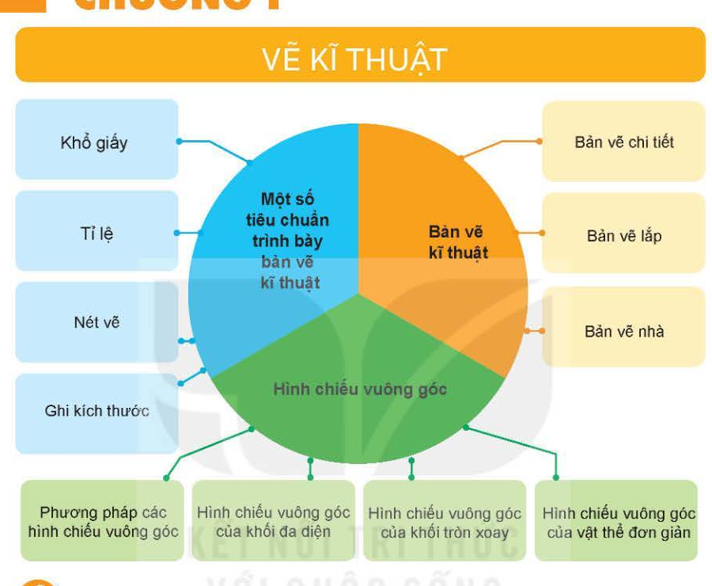

# ÔN TẬP CHƯƠNG I: VẼ KĨ THUẬT

## Sơ Đồ Tư Duy Hệ Thống Hóa Kiến Thức

Chương I bao gồm 3 phân nhánh kiến thức trọng tâm kết nối chặt chẽ với nhau:

---

## Bảng Đối Soát 3 Loại Bản Vẽ Kĩ Thuật

| Tiêu chí so sánh | Bản vẽ chi tiết | Bản vẽ lắp | Bản vẽ nhà |
| :--- | :--- | :--- | :--- |
| **Đối tượng biểu diễn** | Một chi tiết đơn lẻ (Ví dụ: trục, ống lót, bulông) | Một cụm máy / sản phẩm hoàn chỉnh gồm nhiều chi tiết | Một công trình kiến trúc xây dựng (nhà ở, trường học...) |
| **Các hình biểu diễn chính** | Hình chiếu đứng, hình chiếu cạnh, hình cắt | Hình chiếu, hình cắt thể hiện sự lắp ghép giữa các chi tiết | Mặt bằng (hình cắt bằng), Mặt đứng, Mặt cắt thẳng đứng |
| **Kích thước** | Kích thước đầy đủ để chế tạo và kiểm tra | Kích thước chung, kích thước lắp ghép giữa các chi tiết | Kích thước đất, kích thước bao, kích thước từng phòng |
| **Bảng kê chi tiết** | **Không có** | **BẮT BUỘC CÓ** (STT, tên chi tiết, số lượng, vật liệu) | **Không có** (thường có bảng thống kê cửa) |
| **Yêu cầu kĩ thuật** | **BẮT BUỘC CÓ** (chỉ dẫn gia công, xử lý bề mặt) | **Không có** | Chỉ dẫn thi công riêng |
| **Công dụng** | Dùng để chế tạo và kiểm tra chi tiết máy | Dùng để lắp ráp, kiểm tra và vận hành sản phẩm | Dùng để thiết kế và thi công xây dựng công trình |

---

## 10 Câu Hỏi Trọng Tâm Ôn Tập Chương I

1. Nêu đặc điểm các hình chiếu của: hình hộp chữ nhật, hình lăng trụ tam giác đều và hình chóp tứ giác đều?
2. Đối với khối đa diện đều, cần bao nhiêu hình chiếu để đủ biểu diễn hình dạng và kích thước?
3. Nêu đặc điểm các hình chiếu của: hình trụ, hình nón và hình cầu?
4. Để biểu diễn một khối tròn xoay, cần bao nhiêu hình chiếu?
5. Nêu 3 bước cơ bản để vẽ hình chiếu vuông góc của vật thể đơn giản?
6. Nêu trình tự 5 bước đọc bản vẽ chi tiết?
7. Nêu cách đọc bản vẽ chi tiết để hiểu hình dạng của chi tiết?
8. Nêu trình tự 6 bước đọc bản vẽ lắp?
9. Nêu trình tự 4 bước đọc bản vẽ nhà?
10. Tại sao trong bản vẽ nhà, **Mặt bằng** lại được coi là hình biểu diễn quan trọng nhất?
